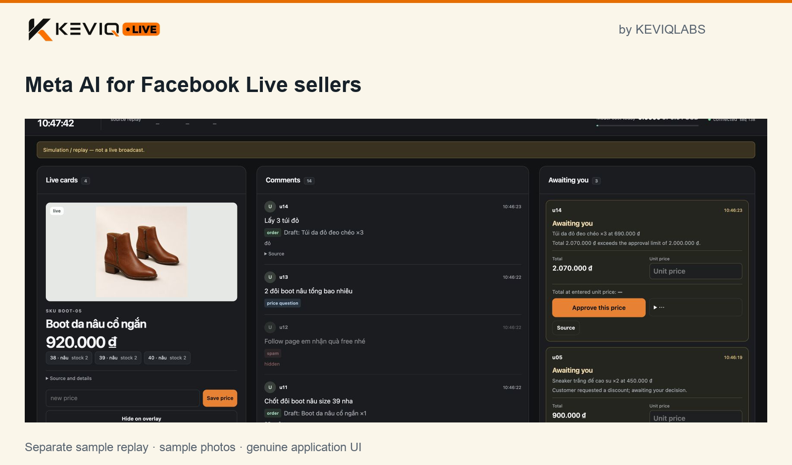

# KEVIQ LIVE

**A seller control room for Facebook Live, powered by Meta AI.**

Built by [KeviqLabs](https://keviqlabs.com/vi/company/), a Vietnamese startup. Sell on camera. Stay in control.

[Watch the demo](https://www.youtube.com/watch?v=UCFd-lKgkVM) · [Try the sample](docs/RUN.md#3-mode-1-replay-judge1-no-key-0-usd) · [Architecture](docs/architecture.md) · [Measured results](docs/RESULTS.md)



## The problem: a seller has only two hands

A solo seller holds up a product, describes it and answers questions while Facebook Live comments keep arriving. “Two pairs of these, size 39 — can you do 400 each?” contains an item reference, quantity, variant and price negotiation. The seller must connect it to the right product, decide the price, get confirmation and remember what was agreed, while continuing the broadcast.

KEVIQ LIVE brings that work into one operating view: product cards, actionable comments, a seller decision queue and an order summary. The opportunity is specific to live commerce: use Meta's visual and language models to understand the context around Facebook Live comments, then turn it into a workflow the seller can control.

## Three journeys through the console

### 1. From the product on screen to a visual card

Muse Spark reads product frames and extracts product and price information from seller-provided text. SAM cuts the item out of its frame for the card image. Timestamped card history keeps earlier products available when the conversation moves on. The seller can inspect the picture, item details and price together instead of reconstructing them from the comment stream.

### 2. From a purchase comment to an agreed order

Spark extracts the shopper's intent, item reference, quantity, size and colour. The application uses product-card context to prepare an order. Discounts, price changes and orders above the seller threshold enter the decision queue.

In the recorded demonstration, two pairs at 450,000 VND each become a request for 400,000 VND per pair. The seller approves 400,000; the customer is asked to confirm the 800,000 VND total. Only the customer's confirmation advances the order to confirmed. Its receipt keeps the quoted card version and, when that version has one, its product image.

**The model proposes. The seller sets the terms. The customer confirms.** No payment is collected.

### 3. From scattered comments to a controlled session

The console groups seller decisions and unresolved product references into a visible queue. Contextual controls let the seller inspect a comment, select an available product candidate or open its existing order. Order filters and the summary separate waiting, confirmed and cancelled states and show confirmed order value; that value is not collected revenue. English and Vietnamese labels support desktop and mobile use.

A contact shield handles phone-number and link patterns before model calls; model labels also identify scam and spam comments. Hiding occurs inside the demonstration app, not on a real Facebook Page.

## Why Meta models are central

| Model | Role in the product |
|---|---|
| **Muse Spark 1.3** | Reads product frames, interprets purchase comments and extracts item/price information from seller text. The application combines these proposals with card history. |
| **SAM 3.1** | Segments the product image used in cards and, when available, receipts. |
| **Muse Voice Transcribe 1.0** | Converts recorded seller audio into text for the speech-input path. |

The video includes real Spark and SAM calls; its seller price lines are typed. Voice Transcribe is implemented and exercised in separate recorded-video runs. This combines Meta perception and language capabilities with explicit transaction rules: model output cannot grant itself price or confirmation authority. [Model roles and call evidence](docs/DEVELOPMENT-RECORD.md#models-and-what-each-one-does).

## Try the working prototype

The [hosted sample](https://livedemo.keviq.ai/) is available while the demo service runs and requires a separately supplied login. It replays sample events without calling models. The same sample runs locally without a Meta account or API key:

```bash
git clone https://github.com/keviqlabs/keviq-live-submission.git
cd keviq-live-submission
uv sync
make infra-up
make app                         # terminal 1; leave running
make replay SESSION=judge1       # terminal 2
```

Open the console URL printed by the replay. Install git, make, uv and Docker with Compose first; the [run guide](docs/RUN.md#0-clone-and-install) gives setup, expected output and alternate ports. This mode runs the real app, event store, API and console with handwritten stand-ins for model and order events. It demonstrates the workflow, not fresh inference.

To exercise inference, follow [real-model mode](docs/RUN.md#5-mode-3-real-models-paid) with a Meta Model API key. It uses recorded or drawn video and incurs API charges.

## Engineering behind the experience

An append-only PostgreSQL event store connects the media workers, model outputs, order rules and console through validated events. The app is the only writer; event identifiers make ingestion idempotent. Server-sent events update the console. Every model call records its purpose, latency, tokens and ledger cost, with spending caps. Order authority stays in application code.

The [recorded 3 November check](docs/evidence/2026-11-03/make-check-1103.log) reports **2,005 tests passed, 7 skipped**; those seven require local video fixtures not distributed in the repository. See [architecture](docs/architecture.md), [run results](docs/RESULTS.md) and [development evidence](docs/DEVELOPMENT-RECORD.md) for the implementation and verification trail.

## Scope and original contribution

This is a hackathon prototype using recorded video, synthetic comments and simulated Messenger. It does not demonstrate a live camera/RTMP input or production messaging. The separate read-only Facebook connector has received one comment from an ended live video; it has not been tested on a broadcast in progress. Difficult product references and latency remain improvement areas; published stress runs have not met every internal target. [Measurements and limitations](docs/RESULTS.md#what-limits-these-numbers).

The event pipeline, model integration, order workflow, console, tests and replay tools in this repository were authored during the hackathon, starting 26 October 2026 at 23:24 ICT. One entrant built the submission using AI coding assistants. Earlier planning, private prototypes and the development/history disclosures are recorded in the [development record](docs/DEVELOPMENT-RECORD.md#built-during-the-hackathon) and the disclosure below. A voice co-host is future integration work, not a demonstrated capability here.

Apache-2.0 · [License](LICENSE)

<a id="development-history-disclosure"></a>

<details>
<summary>Development tools and public history — full disclosure</summary>

The 4 November presentation update changes only the README, its preserved development record and the sample-console image; application code and the submission tag are unchanged.

## Built during the hackathon

Everything in this repository was made during the event, from 26 October 2026 23:24 ICT; what existed before was two earlier private repositories, planning notes, the Meta Model API account and the shop's Facebook Page, and nothing from those repositories is in this one.

AI coding assistants were used as tools. The entrant is the author, working alone. As of 2 November, GitHub records a review on 75 of the 94 merged pull requests (as a pull request review, or as a comment that gives the review or its verdict); not every review was posted on the pull request, and #73, #74, #78 and #79 went into main on the author's tests, with no verdict posted on the pull request. Some branch names carry an assistant's default prefix: `claude/` on 19 merged PRs (all within #2–#29 and #62–#67) and on closed draft PR #71, and `codex/` on PR #47 and on draft PRs #48–#50, which were closed unmerged and reopened on tool-free branches as #53–#55 (#53 was merged; #54 and #55 were closed). Those prefixes are the default branch names of the coding tools used during the hackathon. The current convention: a pull request is merged under its written title, and commits carry the author's private GitHub address. The public copy of this repository, `keviqlabs/keviq-live-submission`, is made from the working repository at the annotated tag `submission-2026-11-03`; pull requests merged after the tag (#117 onward) are carried onto its `main` the same way, so its `main` is ahead of the tag. In the copy only some commits are changed: an author or committer address that is not a GitHub noreply address is replaced by the author's private GitHub address, and the tool names, internal role labels, decision codes and attribution lines that `make hygiene` rejects are removed from some messages. Commit signatures are not kept; commit dates are preserved. The public copy also replaces one personal absolute environment-file path in each of two historical file versions with the explicit `MAIN_ENV` input already used by the current scripts. This changes 19 historical commit trees; all other file contents are preserved by that redaction. The file contents at the submission tag are unchanged. The tag annotation gives the counts and distinguishes this path redaction from the earlier message and identity cleanup. Nine early merge commits (#1–#8 and #10) keep GitHub's default subject, which names the branch, and in six of them the assistant prefix is removed from the branch name. A changed commit gets a new id, and so does every commit built on it: [`docs/evidence/commit-ids.md`](docs/evidence/commit-ids.md) maps each commit id cited in the repository's Markdown files to its id in the copy. Pull request numbers refer to the working repository, which is private; each commit that merged a pull request into `main` names it, except #53, which went into `main` inside the merge of #61 (`f2c2dba`; `2e41596` in this copy).

</details>
