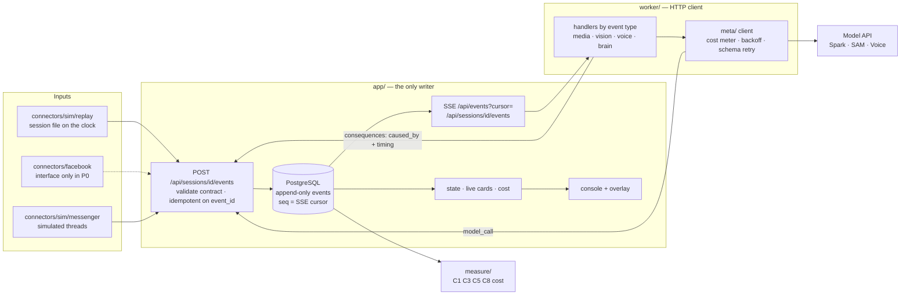

# Architecture

Every event follows `contracts/events/*.schema.json`. A consequence names its trigger in `caused_by` and carries `timing`, which is what `measure/` uses for C1 and C8. Decisions behind this shape: `docs/DECISIONS.md` D-002 to D-006.
